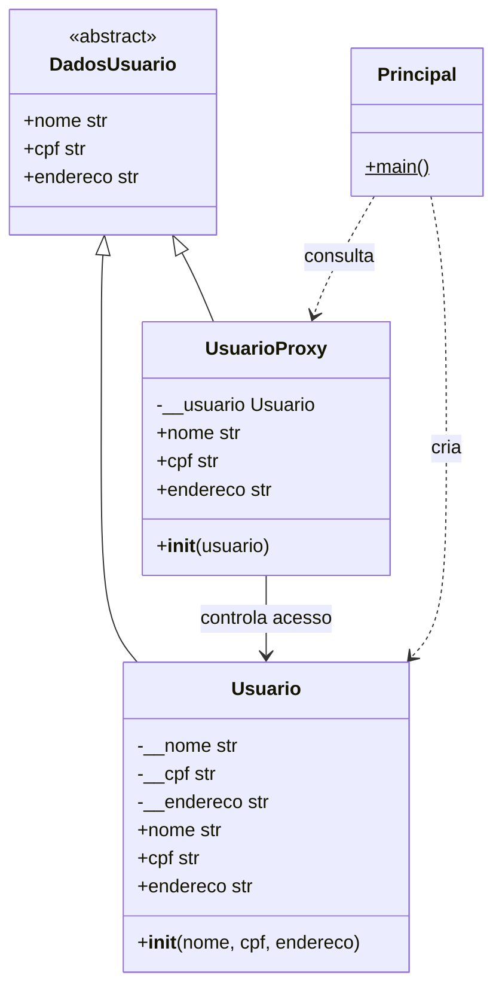

# Diagrama de classes — Proxy

`nome`, `cpf` e `endereco` são propriedades com métodos de leitura.
O Proxy delega a leitura do nome, mascara o CPF e lança `PermissionError`
ao tentar ler o endereço. O objeto real é mantido em um atributo privado.
